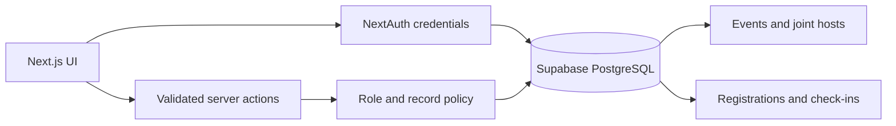

# CollabSphere

CollabSphere gives IIT Madras online-degree learners a trusted local community layer. Students discover regional meetups, student coordinators propose cross-house events, and admins approve both memberships and events. QR proof of presence awards activity points.

## Roles

| Role                | Capabilities                                                                                                  |
| ------------------- | ------------------------------------------------------------------------------------------------------------- |
| Admin               | Create and publish meetups, approve coordinator proposals, approve student signups, view the regional network |
| Student coordinator | Propose and co-host events across houses, track proposals, join approved events                               |
| Student             | Explore the map, register for approved meetups, check in and earn points                                      |

New public signups are always created as pending students. They cannot authenticate until an admin approves them. Role elevation is an administrative database operation.

## Key features

- Interactive regional map for approved meetups and coworking sessions
- Joint-event host manager with multiple house coordinators
- Admin approval queues for memberships and coordinator event proposals
- Capacity-aware registration and waitlisting
- QR proof-of-presence check-in with idempotent point awards
- Optional directory of hospitals near IIT Madras for learners who visit campus
- Dark mode, responsive layouts, accessible controls, audit history, and server-side authorization

## Run locally

```bash
npm install
npm run db:migrate
npm run db:seed
npm run dev
```

Open `http://localhost:3000`.

Copy `.env.example` to `.env.local` and configure `DATABASE_URL`, `NEXTAUTH_URL`, and `NEXTAUTH_SECRET` first. Generate secrets with `npm run setup:secrets` when needed.

Demo password: `demo1234`

| Role                | Email                    |
| ------------------- | ------------------------ |
| Admin               | `admin@iitm.ac.in`       |
| Student coordinator | `coordinator@iitm.ac.in` |
| Student             | `student@iitm.ac.in`     |

## Architecture



The App Router renders read views on the server. Mutations use server actions with Zod validation and server-side role checks. Prisma owns the relational model and migration history. Former hospital-authorization code is preserved under `legacy/hospital-workflow` for auditability and excluded from the active build.

## Quality checks

```bash
npm run format:check
npm run typecheck
npm run lint
npm test
npm run build
```

Production deploys run `npm run db:migrate && npm run build` through `vercel.json`.
