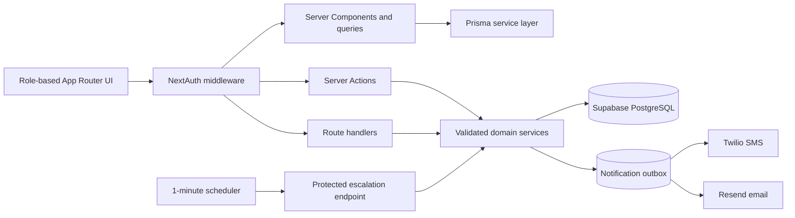

# CampusCare

CampusCare is a full-stack hospital visit authorization and emergency escalation system for the IIT Madras community. Students submit a visit once, proctors act from a role-scoped queue, parents follow linked students, and administrators manage the institution without spreadsheets or paper trails.

This is a Build-a-Thon 2026 project, not an official IIT Madras service.

## What it solves

1. A student selects a registered hospital, visit time, reason, and emergency priority.
2. The assigned proctor approves, rejects with a reason, or escalates.
3. A protected background job escalates unattended emergency requests after the configured deadline.
4. Notification jobs email the proctor and, on escalation, send an SMS to the linked parent. Demo mode records the message without contacting anyone.
5. Approval creates an opaque QR pass. Public verification shows authorization details and never exposes the medical reason.

## Product surfaces

- **Student:** responsive overview, submission, live status, audit timeline, nearby hospitals, QR pass, and print view.
- **Proctor:** assigned-student queue, search, filters, comments, individual and bulk review, and CSV export.
- **Parent:** read-only view restricted to linked children.
- **Administrator:** KPIs, trends, requests, care-team assignments, hospital registry, notification logs, settings, templates, and activity history.

## Architecture



Business rules live in `lib/services`, authorization scopes in `lib/access.ts`, validation in `lib/validations.ts`, and persistence in Prisma. Status transitions, audit writes, pass creation, and notification enqueueing share database transactions. Conditional updates prevent concurrent reviewers or job invocations from applying the same transition.

See [docs/architecture.md](docs/architecture.md) for trust boundaries and delivery semantics.

## Stack

| Area                | Choice                                                                 |
| ------------------- | ---------------------------------------------------------------------- |
| Application         | Next.js 15 App Router, React 19, strict TypeScript                     |
| Authentication      | NextAuth credentials, JWT sessions, database-backed rate limiting      |
| Database            | Supabase PostgreSQL through Prisma                                     |
| Validation and data | Zod, Server Actions, route handlers, TanStack Query                    |
| UI                  | Tailwind CSS, CSS tokens, next-themes, Framer Motion, Recharts, Sonner |
| Delivery            | Twilio SMS and Resend email, simulated by default                      |
| Verification        | Vitest, Playwright, axe-core, ESLint, production build                 |

## Local setup

Requirements: Node.js 20+, npm, and PostgreSQL.

```powershell
git clone https://github.com/akxxh222/CollabSphere-Cross-House-And-Regional-Meetup-Engine.git
cd CollabSphere-Cross-House-And-Regional-Meetup-Engine
npm install
Copy-Item .env.example .env.local
node scripts/setup-secrets.cjs
```

Fill `DATABASE_URL`. Remove the square brackets from the Supabase example and URL-encode reserved password characters such as `@` → `%40`, `#` → `%23`, and `:` → `%3A`.

```powershell
npm run db:check
npm run db:migrate
npm run db:seed
npm run dev
```

Run `npm run worker` in a second terminal, then open <http://localhost:3000>.

## Demo accounts

The seed password defaults to `demo1234`; set `DEMO_SEED_PASSWORD` before seeding to override it. Change all demo passwords before public deployment.

| Role                              | Email                 |
| --------------------------------- | --------------------- |
| Student                           | `student@iitm.ac.in`  |
| Assigned proctor                  | `proctor@iitm.ac.in`  |
| Unassigned proctor (access tests) | `proctor2@iitm.ac.in` |
| Parent                            | `parent@example.org`  |
| Administrator                     | `admin@iitm.ac.in`    |

## Environment variables

| Variable                                                         |   Required | Purpose                                                    |
| ---------------------------------------------------------------- | ---------: | ---------------------------------------------------------- |
| `DATABASE_URL`                                                   |        Yes | PostgreSQL connection URL                                  |
| `NEXTAUTH_SECRET`                                                |        Yes | Session signing; generate with `scripts/setup-secrets.cjs` |
| `NEXTAUTH_URL`                                                   |        Yes | Canonical origin                                           |
| `CRON_SECRET`                                                    |        Yes | Bearer secret for `/api/jobs/escalate`                     |
| `TWILIO_MOCK_MODE`                                               |        Yes | `true` for safe demos; `false` enables SMS                 |
| `TWILIO_ACCOUNT_SID`, `TWILIO_AUTH_TOKEN`, `TWILIO_PHONE_NUMBER` |   Live SMS | Provider credentials and sender                            |
| `EMAIL_MOCK_MODE`                                                |        Yes | `true` for safe demos; `false` enables email               |
| `RESEND_API_KEY`, `EMAIL_FROM`                                   | Live email | Provider credential and verified sender                    |
| `DEMO_SEED_PASSWORD`                                             |   Optional | Overrides the local demo password                          |

## Commands

| Command              | Use                                                 |
| -------------------- | --------------------------------------------------- |
| `npm run dev`        | Development server                                  |
| `npm run worker`     | Local escalation/notification worker                |
| `npm run db:migrate` | Apply committed migrations                          |
| `npm run db:seed`    | Seed fictional data; live notifications must be off |
| `npm run db:check`   | Redacted database and secret health check           |
| `npm run typecheck`  | Strict TypeScript check                             |
| `npm test`           | Domain unit tests                                   |
| `npm run test:e2e`   | Four-role browser, access, mobile, and axe tests    |
| `npm run lint`       | ESLint checks                                       |
| `npm run build`      | Production build                                    |

## Deployment

1. Import this repository into Vercel and add all required variables.
2. Set `NEXTAUTH_URL` to the production origin and use production secrets.
3. Apply `npm run db:migrate`. Seed only a dedicated demo environment.
4. Deploy through Git integration or `vercel deploy --prod`.
5. Schedule `GET /api/jobs/escalate` every minute with `Authorization: Bearer <CRON_SECRET>`.

Vercel Hobby cron cannot meet a three-minute deadline because its schedule is limited and imprecise. Use Vercel Pro cron or another trusted one-minute scheduler. The job is idempotent and the database is the source of truth.

No live URL is claimed until deployment and environment configuration are verified.

## Repository map

```text
app/                    role route groups, APIs, verification page
components/             shared UI and workflow components
lib/actions/            server-action adapters
lib/services/           lifecycle and notification delivery
lib/access.ts           role and record-level scopes
lib/queries.ts          filtering, pagination, analytics
prisma/                 schema, migration, deterministic seed
scripts/                secret setup, database wrapper, worker
tests/                  domain and end-to-end tests
docs/                   architecture and data provenance
```

Hospital provenance is in [docs/data-sources.md](docs/data-sources.md), contributor workflow in [CONTRIBUTING.md](CONTRIBUTING.md), and deployment safety in [SECURITY.md](SECURITY.md).
