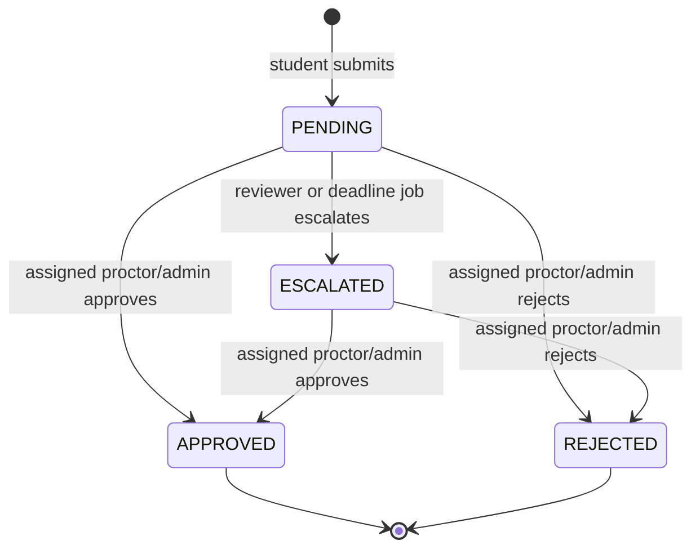

# Architecture and trust boundaries

CampusCare uses a server-first Next.js App Router architecture. Pages read through Server Components; client components handle forms, live refresh, charts, dialogs, and feedback. The browser is never trusted to enforce role or record ownership.

## Request lifecycle

The transaction contains the guarded status update, audit record, opaque pass token, and notification outbox writes. A status predicate provides optimistic concurrency. Repeated or simultaneous requests return a conflict.

## Authorization

- Middleware prevents crossing role route groups.
- Every server action and route handler independently calls `requireActor`.
- Students see themselves, proctors assigned students, parents linked children, and administrators all records.
- Public verification uses a random 192-bit token and selects only student ID, hospital, visit window, and status.
- Credentials are rate-limited in PostgreSQL. Active status and role are re-read on every server access.
- Mutating JSON endpoints validate request origin; all inputs use Zod.

## Escalation and delivery

`GET /api/jobs/escalate` requires a constant-time checked bearer secret. It selects overdue pending emergencies, conditionally claims each in a transaction, records a system event, and inserts deduplicated notifications.

The dispatcher conditionally claims messages. Simulation is the default. `SENT` means provider accepted, not recipient delivered. A timeout has an unknown outcome and is not blindly retried, avoiding duplicate parent alerts.

The local worker polls every 15 seconds. Production needs a scheduler at least every minute to meet a three-minute policy.

## Operational boundaries

- Medical reasons are sensitive; define access and retention policies before institutional use.
- Demo data is fictional, and seeding refuses to run when live delivery is enabled.
- Hospital distances are approximate; users are told to confirm services.
- This does not replace emergency services; emergency screens tell students to seek immediate help directly.
