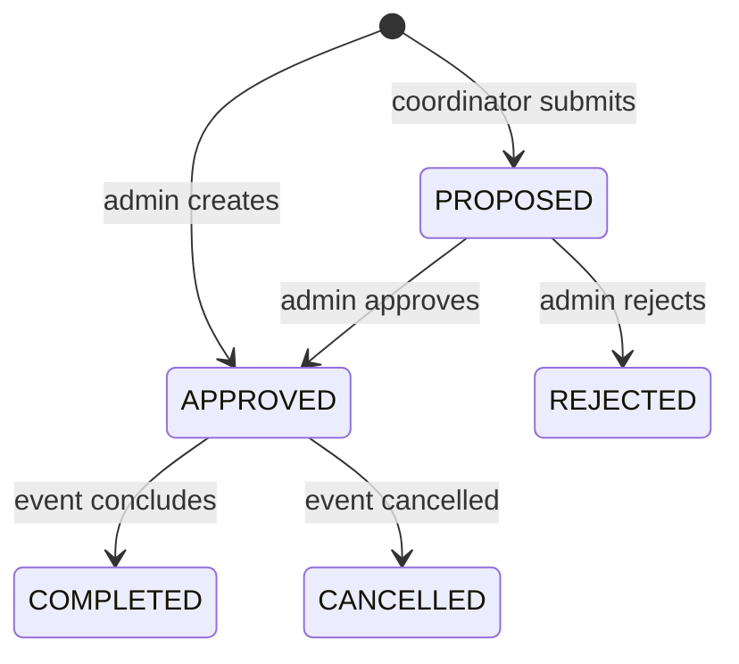

# Architecture

CollabSphere uses server-rendered Next.js App Router pages, NextAuth credentials sessions, validated Server Actions and a relational Prisma model on Supabase PostgreSQL.

## Trust boundaries

- Only approved, active users can authenticate.
- Middleware protects role URL spaces; every mutation independently calls `requireActor`.
- Public signup always creates a pending student. Clients cannot choose a privileged role.
- Admins approve memberships and event proposals.
- Coordinators create proposals and may select approved coordinators as joint hosts.
- Students and coordinators may register only for approved events.
- Check-in requires both an authenticated member and an existing registration.

## Event lifecycle

`EventHost` gives an event multiple coordinators or houses without duplicating event data. `Registration` has a compound event/user key, and `CheckIn` uses the same constraint to prevent duplicate presence awards. The check-in transaction creates presence, marks attendance, and increments points together.

## Data retention

The product migration disables former parent accounts, maps former proctors to coordinators, and archives old hospital workflow tables. The source snapshot lives under `legacy/hospital-workflow` and is excluded from TypeScript builds. The active `Hospital` table remains as a read-only reference for services near IIT Madras.
